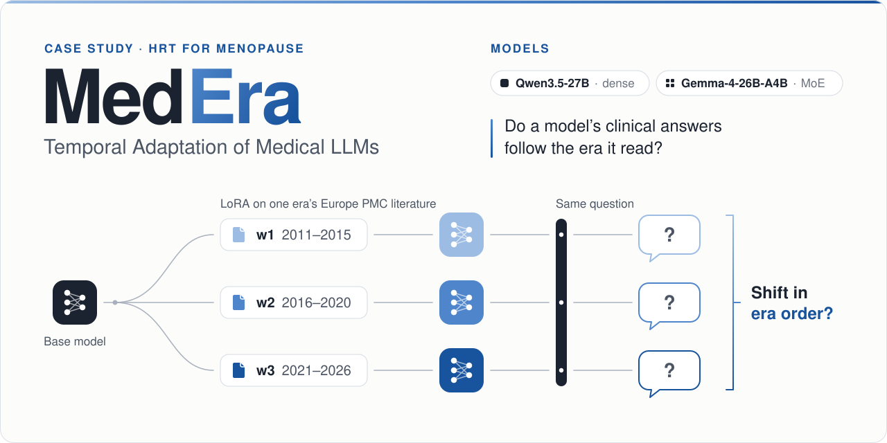
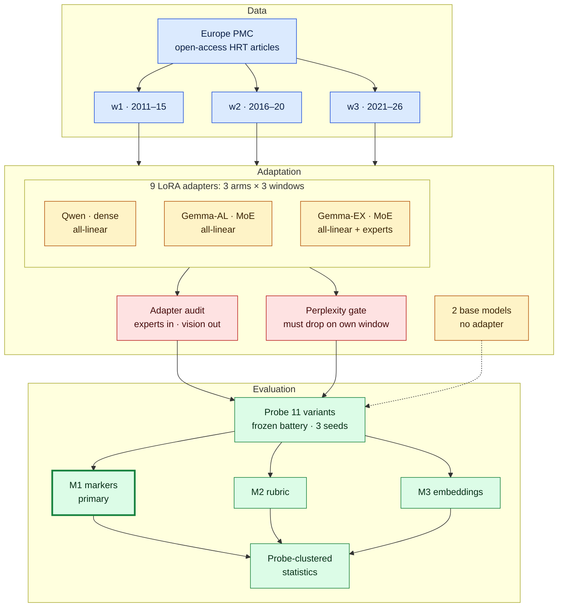

<div align="center">

# MedEra: Temporal Adaptation of Medical LLMs

**Studying how LoRA/QLoRA training on medical literature from different eras shifts LLM responses.**

[](#roadmap)
[](https://www.python.org/)
[](https://huggingface.co/docs/peft)
[](https://europepmc.org/)
[](LICENSE)

[The question](#the-question) · [Design](#design) · [How it works](#how-it-works) · [Measures](#measures-and-analysis) · [Corpus](#corpus) · [Results](#results) · [Roadmap](#roadmap)

</div>

MedEra adapts the same language model to medical literature from one period at a time and asks
whether its clinical answers **shift to match the period it read**. The case study is hormone
replacement therapy (HRT) for menopause, where guidance changed several times between 2011 and 2026.

<p align="center">
  
</p>

> [!IMPORTANT]
> MedEra is research only. The era adapters reproduce older clinical guidance by design. They are not
> medical tools and must not be used for clinical advice. The study measures stance, not clinical
> correctness.

## At a glance

| | |
|:--|:--|
| **Question** | Does continued pretraining on one era's HRT literature move a model's HRT stance toward that era? |
| **Eras** | Three windows:<br>2011–2015<br>2016–2020<br>2021–2026 |
| **Models** | Qwen3.5-27B (dense)<br>Gemma-4-26B-A4B (mixture of experts) |
| **Adaptation** | bf16 LoRA continued pretraining, one adapter per window, equal token budget |
| **Variants** | 11: 9 adapters and 2 base models |
| **Corpus** | Open-access HRT articles from Europe PMC, assigned to a window by first publication date |
| **Primary measure** | Rate of individualization language, from rule-based markers (no judge) |
| **Status** | In progress: AAI 6620 final project, Fall 2026. Corpus hit counts done; no results yet. |

## The question

A language model learns medicine from a fixed snapshot of the literature, and nothing in its answers
says how old that snapshot is. HRT is a clear test case because the guidance moved in documented steps:

- **ELITE (2016)** supported starting therapy near menopause rather than years later.
- **NAMS 2017**, the North American Menopause Society position statement, made the initiation window
  explicit: under age 60 or within 10 years of menopause.
- **NAMS 2022** made individualized, symptom-driven prescribing the standard and advised against HRT
  for chronic-disease prevention alone.

| Window | Years | Clinical context |
|:--|:--|:--|
| w1 | 2011–2015 | Before ELITE and the 2017 NAMS statement |
| w2 | 2016–2020 | ELITE (2016); NAMS 2017 timing window |
| w3 | 2021–2026 | NAMS 2022: individualized, not for prevention alone |

### Research questions

1. **RQ1.** Does continued pretraining on era-specific HRT literature shift a model's HRT stance in
   era order (w1 → w2 → w3)?
2. **RQ2.** For the mixture-of-experts model, does adapting the expert weights change the outcome
   compared with standard `all-linear` LoRA?
3. **RQ3.** Do three independent measures (lexical markers, a judged rubric, embedding geometry)
   agree, and how much does answer length drive each?

## Design

| Arm | Model | Adapter | Variants |
|:--|:--|:--|:--|
| **Qwen** | Qwen3.5-27B, dense | bf16 LoRA, `all-linear` | base, w1, w2, w3 |
| **Gemma-AL** | Gemma-4-26B-A4B, MoE | bf16 LoRA, `all-linear`, text model only | base, w1, w2, w3 |
| **Gemma-EX** | Gemma-4-26B-A4B, MoE | Gemma-AL plus the expert weights, via PEFT `target_parameters` | w1, w2, w3 (shares the Gemma base) |

<sub>The independent variable is the publication era of the adaptation corpus. Every adapter trains
from the base checkpoint on the same number of tokens from one window.</sub>

**The MoE recipe (RQ2).** Gemma-4-26B-A4B routes each token to a few expert sub-networks and uses
about 4B of its 26B parameters per token. Its expert weights are stored as fused parameter tensors,
so standard `all-linear` LoRA never adapts them. Gemma-EX targets those tensors directly.

- Gemma-AL and Gemma-EX differ in one thing only: whether the experts are adapted.
- Both run in bf16 and exclude the vision tower, so precision and vision parameters are not confounds.
- Gemma-EX has more trainable parameters than Gemma-AL. The counts are reported, not matched.
- A smoke test confirms that PEFT reaches the fused experts. If it does not, the experts are first
  split into per-expert linear layers so that Gemma stays in the study.

**Stretch arms**, run only if the core study finishes early: a cumulative 2011–2026 window per arm,
a Gemma 4-bit QLoRA arm to test precision separately, and a general women's-health corpus to compare
a diluted corpus with an HRT-dense one.

## How it works



<sub>Each arm gets one adapter per window, all trained on the same token budget; the 2 base models
skip training and are probed as they are (dotted line).</sub>

**Data.** Every window is collected and cleaned the same way and contributes the same number of
training tokens.

- **Collect.** Search and full-text XML from the Europe PMC REST API, open-access subset only, with
  one collector per window.
- **One window per paper.** Each article is assigned by its first publication date. A merge step
  removes duplicates across windows and checks that no paper appears in two.
- **Minimal cleaning.** JATS XML is flattened to text, and reference lists, tables, figures, back
  matter and inline citation markers are dropped. Casing, punctuation, numbers and negation are kept,
  with no lowercasing, stemming or stop-word removal, because the model's subword tokenizer needs
  them.
- **Held-out split.** About 5% of each window is held out (seed 42) for the perplexity checks.
- **Equal-token budget.** Every adapter makes one pass over the token count of the smallest window.
  Larger windows are randomly downsampled to match, so era is not confounded with data volume or
  epochs.

**Adaptation.** Each arm adapts its base model to each window separately, and two checks run before
anything is probed.

- **Train.** LoRA continued pretraining on raw article text, from pinned base checkpoints. There is
  no instruction tuning, chat tuning or full fine-tuning.
- **Adapter audit.** Lists adapted tensors and parameter counts by group (attention, dense MLP,
  router, experts, vision). The run fails unless Gemma-EX adapts more than zero expert tensors with
  nonzero gradients and no arm adapts vision tensors.
- **Perplexity gate.** Each adapter must lower held-out perplexity on its own window. A failing
  adapter is checked for bugs and rerun once with the same settings. If it still fails, it is probed
  anyway and the failure is reported. Epochs, budget and windows never change after training starts.

<details>
<summary>Training settings</summary>

| Setting | Value |
|:--|:--|
| LoRA | r = 16, α = 32, dropout 0.0 |
| Optimizer | AdamW, learning rate 2e-4 |
| Precision | bf16 |
| Block length | 2048 tokens |
| Data per adapter | One pass at the equal-token budget |
| Seed | 42 |
| Compute | One H200 GPU per job on Northeastern's Explorer cluster |

</details>

**Evaluation.** All 11 variants answer the same frozen question battery in the same format, and
three measures score the answers.

- **Battery.** About 19 probes cover eligibility, timing and age, cardiovascular prevention,
  contraindications, dosing and patient vignettes. Each has an original wording and at least one
  paraphrase.
- **Prompt format.** Completion-style prompts with a neutral, non-HRT format primer and no chat
  template, so base models and adapters are queried the same way.
- **Decoding.** Sampled decoding with 3 seeds gives about 130 answers per variant and about 1,400 in
  total. One greedy pass is kept as a descriptive comparison.
- **Frozen in advance.** The battery, seeds and decoding settings are frozen before any adapter is
  probed.
- **Scoring.** M1 markers (primary), M2 rubric and M3 embeddings, then probe-clustered statistics, as
  set out in [Measures and analysis](#measures-and-analysis).

## Measures and analysis

| Measure | What it captures | Role |
|:--|:--|:--|
| **M1 Markers** | Rule-based counts of individualization language, plus secondary markers: WHI mentions, age or timing restrictions, symptom-severity gates, prevention advice | **Primary**; no judge |
| **M2 Rubric** | 0/1/2 on five dimensions (eligibility, cardiovascular-risk framing, timing hypothesis, dosing and route, contraindications), scored blind by Claude Opus judge agents | Supporting |
| **M3 Embeddings** | Movement along a w1 → w3 axis (centroid of w3 minus centroid of w1) in BioLORD-2023 and bge-base-en-v1.5 space, centered within probe | Supporting; judge-free |
| **Perplexity check** | Held-out perplexity before and after adaptation, and an era × era perplexity matrix | Precondition, not a stance measure |

- **Length.** Every measure is reported raw and adjusted for log word count, because longer answers
  can look more complete without a change in stance.
- **Rubric anchors** score coverage and specificity on each dimension, not agreement with the 2022
  guidance.
- **Judge protocol.** Answers are anonymized and shuffled across variants and scored in batches of
  about 50, with the answer-to-variant key kept in a separate file. Every judge receives the same
  fixed rubric instruction. A fresh judge agent scores each batch and records the model ID it ran on.
  Score files are validated against a schema, and failed batches are re-queued. 150 answers are scored
  twice by separate agents, and test–retest agreement (κ) is reported.
- **Marker validation.** 150 random answers are hand-labelled for individualization, blind to
  variant. The markers' precision, recall and Cohen's κ against those labels are reported.

**Statistics.**

- **Unit of analysis:** the probe. Seeds and paraphrases nest inside it.
- **RQ1:** era trend per arm by cluster-robust logistic regression on ordinal era, clustered by
  probe, two-sided. Cochran–Armitage is reported descriptively.
- **RQ2:** the era × recipe interaction (Gemma-EX vs Gemma-AL), plus era × arm against Qwen.
- **Primary family:** four tests (the individualization trend for each arm, plus the era × recipe
  interaction), Bonferroni-corrected at α = .0125. Secondary markers, M2 and M3 form a separate family.
- **Nulls:** equivalence tested with TOST, odds-ratio bound [0.67, 1.5] per era step.
- **M2:** ΔS = S(w3) − S(w1), with probe-cluster bootstrap confidence intervals.
- **M3:** era-axis statistic T, with a 10,000-draw within-probe permutation test that refits the
  axis inside every permutation.
- **Directional expectations,** stated in advance but not tested one-sided: individualization up,
  timing-window language up after w1, WHI mentions down, prevention advice down.

All of the above is written into a pre-registration that is committed and git-tagged before any
trained adapter is probed. A null result from a verified recipe counts as a finding.

### Scope and limitations

- The study measures stance, not clinical correctness.
- No clinician reviews the probes or the answers. The probes are checked against the NAMS 2017 and
  2022 statements before the freeze.
- The base models may already have seen recent literature in pretraining. Adaptation steers a model;
  it does not replace what the model already knows.
- Out of scope: retrieval-augmented generation, instruction or chat tuning, and full fine-tuning.

## Corpus

**Inclusion.** HRT or menopausal hormone therapy terms in the title, abstract, keywords or MeSH
headings, English only. Each article belongs to exactly one window, by its first publication date.

**Exclusions.** Corrections, errata and retraction notices; texts under 800 characters; duplicates
(by PMCID, with DOI as fallback).

**Available volume.** Europe PMC hit counts per window, retrieved 2026-11-04:

| Window | HRT query, all records | HRT query, open-access full text | Fallback menopause query, open-access full text |
|:--|--:|--:|--:|
| w1 · 2011–2015 | 5,159 | **676** | 3,305 |
| w2 · 2016–2020 | 4,703 | **1,194** | 6,375 |
| w3 · 2021–2026 | 6,057 | **2,902** | 15,067 |

<sub>Source: [`data/manifests/counts.csv`](data/manifests/counts.csv), which also holds the exact
query strings. These are **pre-filter hit counts**, taken before relevance filtering and
exclusions, so the final sets will be smaller. Training uses open-access full text only.</sub>

A minimum of 2 million training tokens in the smallest window is set in advance. If filtering leaves
less, the study switches to the broader menopause query in the last column before any training. That
choice depends only on counts, never on results. Final document and token counts per window will be
reported in table T1.

## Results

> [!NOTE]
> No results yet. Training and probing have not started. Everything below is a placeholder.

| Arm | base | w1 | w2 | w3 | Era trend |
|:--|--:|--:|--:|--:|:--|
| Qwen | _pending_ | _pending_ | _pending_ | _pending_ | _pending_ |
| Gemma-AL | _pending_ | _pending_ | _pending_ | _pending_ | _pending_ |
| Gemma-EX | shares Gemma base | _pending_ | _pending_ | _pending_ | _pending_ |

<sub>Headline table (T4): individualization-marker rate by arm and window, with the two-sided trend
test.</sub>

**Planned outputs**

- **Tables:** T1 corpus by window · T2 adapter audit · T3 perplexity check · T4 headline marker rates
  · T5 interactions (Gemma-EX vs Gemma-AL; Qwen vs each Gemma arm) · T6 rubric ΔS per dimension · T7
  embedding T per encoder, raw and length-adjusted · T8 agreement between measures and length
  sensitivity
- **Figures:** F1 pipeline · F2 marker trend w1 → w3 per arm · F3 embedding PCA by probe and by era ·
  F4 rubric dimensions by era · F5 side-by-side w1 and w3 answers for the same probe and seed

## Documents

All planned; each will be linked here once it is published.

- **Pre-registration** (`docs/preregistration.md`): hypotheses, primary measure and test, test
  family, α, equivalence bound and perplexity gate. Git-tagged before probing.
- **Report** (`docs/report.md`): methods, results and limitations.
- **Slides** (`docs/slides/`): final presentation.
- **Model card** (`MODEL_CARD.md`): intended use (research only), training data, limits and safety.

## Reproduce

> [!NOTE]
> Planned. The pipeline is not built yet, so these steps describe the intended order, and script
> names may change.

**Requirements (planned):** Python with pinned versions in `requirements.txt`, and one H200-class GPU
per job for training and probing. Core training plus probing is estimated at 30–40 H200-hours. The
notebooks run on a CPU from saved results, so every table and figure can be rebuilt without a GPU.

1. **Environment.** Install `requirements.txt`; on Explorer, run `hpc/setup_env.sh`.
2. **Collect.** `python -m medera.collect harvest --window w1 --query core --resume`, then w2 and w3,
   then `python -m medera.collect merge`. Raw XML goes to
   `data/raw/` and one manifest per window to `data/manifests/`; the merge step removes duplicates.
3. **Build.** Clean, split by window, apply the equal-token budget and pack into 2048-token blocks.
4. **Train and audit** the 9 adapters on Explorer with the Slurm jobs in `hpc/`, then run the
   perplexity gate.
5. **Probe** all 11 variants with the frozen question battery.
6. **Measure** with markers, rubric and embeddings, then run the statistics.
7. **Rebuild** every table and figure from `results/` with the notebooks in `notebooks/`.

## Repository structure

```text
configs/          corpus queries, model revisions, training arms, probe battery, rubric judge
data/
  manifests/      paper IDs, dates, licenses and hit counts (committed)
  raw/            article XML (local only, never committed)
  processed/      cleaned, windowed text (local only, never committed)
docs/             pre-registration, report, slides
hpc/              environment setup and Slurm jobs for the Explorer cluster
notebooks/        analysis notebooks; CPU only, read from results/
results/
  adapter_audit/  adapted tensors and parameter counts per arm
  answers/        probe answers for every variant
  scores/         marker, rubric and embedding scores
  tables/         T1–T8
  figures/        F1–F5
scripts/          entry points: collect, build, train, probe, measure, report
src/medera/
  collect/        Europe PMC client, harvest, merge and dedup
  preprocess/     JATS to text, cleaning, window split, token budget
  train/          LoRA continued pretraining and adapter audit
  probe/          answer generation for the question battery
  measure/        markers, rubric, embeddings, perplexity
  stats/          trend tests, clustering, permutation, bootstrap
tests/            preprocessing, markers, statistics, adapter audit
```

## Roadmap

- [x] Repository skeleton
- [x] Europe PMC hit counts per window (2026-11-04)
- [ ] Corpus harvest and build, one window at a time
- [ ] Gemma-EX smoke test: the adapter reaches the expert weights (go/no-go)
- [ ] Probe battery drafted and checked against NAMS 2017 and 2022
- [ ] Pre-registration frozen and git-tagged
- [ ] Train and audit 9 adapters; perplexity gate
- [ ] Probe 11 variants; markers and embeddings
- [ ] Rubric judging, statistics and marker validation
- [ ] Report, model card and figures
- [ ] Final presentation

## Citation

```bibtex
@software{obaidullah2026medera,
  author = {Obaidullah, Muhammad},
  title  = {MedEra: Temporal Adaptation of Medical LLMs},
  year   = {2026},
  url    = {https://github.com/as-obaid/med-era}
}
```

## Data, licensing and acknowledgements

- **Corpus:** open-access literature retrieved through the Europe PMC API. Raw article text is not
  redistributed. The manifests in `data/manifests/` list every paper (PMCID, DOI, title, journal,
  first publication date, license and matched terms), so the corpus can be rebuilt.
- **Licenses:** each article's license is recorded in its manifest row.
- **Adapters:** trained adapters stay private and are not published.
- **Base models:** Qwen3.5-27B and Gemma-4-26B-A4B, used under their own licenses.
- **Code:** MIT, see [LICENSE](LICENSE).

Thanks to Europe PMC and the authors of the open-access articles in the corpus, and to Northeastern
University Research Computing for the Explorer cluster. MedEra is the term project for AAI 6620
Applied Natural Language Processing at Northeastern University.

## Author

**Muhammad Obaidullah** · [abdulsalam.m@northeastern.edu](mailto:abdulsalam.m@northeastern.edu)
