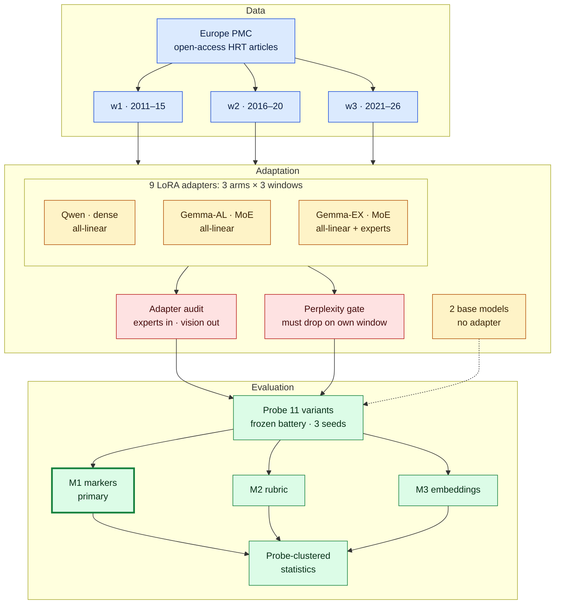
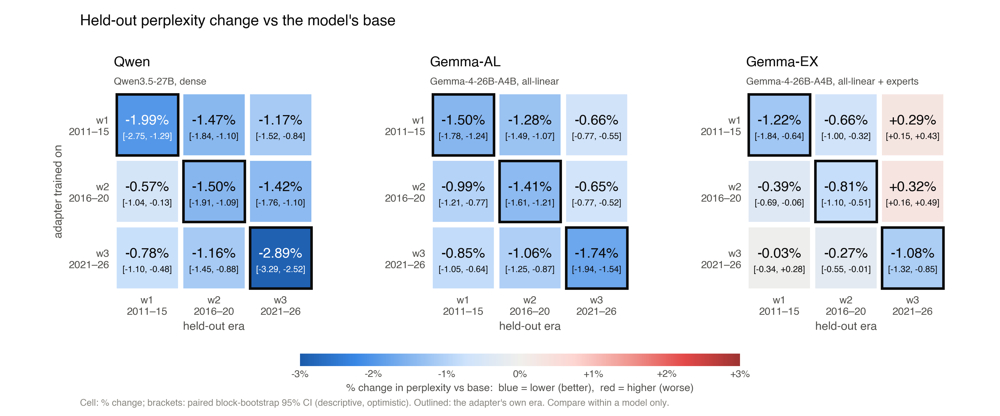
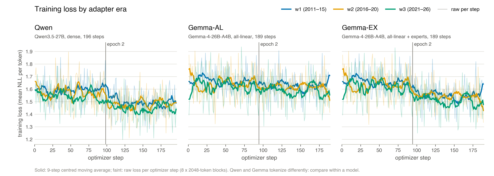

<div align="center">

# MedEra: Temporal Adaptation of Medical LLMs

**Studying how LoRA training on medical literature from different eras shifts LLM responses.**

[](#roadmap)
[](https://www.python.org/)
[](https://huggingface.co/docs/peft)
[](https://europepmc.org/)
[](LICENSE)

[The question](#the-question) · [Design](#design) · [How it works](#how-it-works) · [Measures](#measures-and-analysis) · [Corpus](#corpus) · [Results](#results) · [Documents](#documents) · [Reproduce](#reproduce) · [Roadmap](#roadmap)

</div>

MedEra adapts the same language model to medical literature from one period at a time and asks
whether its clinical answers **shift to match the period it read**. The case study is hormone
replacement therapy (HRT) for menopause, where guidance changed several times between 2011 and 2026.

<p align="center">
  
</p>

> [!IMPORTANT]
> MedEra is research only. The era adapters reproduce older clinical guidance by design. They are not
> medical tools and must not be used for clinical advice. The study measures stance, not clinical
> correctness.

## At a glance

| | |
|:--|:--|
| **Question** | Does continued pretraining on one era's HRT literature move a model's HRT stance toward that era? |
| **Eras** | Three windows:<br>2011–2015<br>2016–2020<br>2021–2026 |
| **Models** | Qwen3.5-27B (dense)<br>Gemma-4-26B-A4B (mixture of experts) |
| **Adaptation** | bf16 LoRA continued pretraining, one adapter per window, equal token budget |
| **Variants** | 11: 9 adapters and 2 base models |
| **Corpus** | 1,913 open-access HRT articles from Europe PMC, kept after a blinded relevance screen and assigned to a window by first publication date |
| **Primary measure** | Rate of individualization language, from rule-based markers (no judge) |
| **Status** | Training and perplexity check done (2026-11-05): 9 of 9 adapters trained, audited and past the perplexity gate. Probing waits on the pre-registration freeze. AAI 6620 final project, Fall 2026. |

## The question

A language model learns medicine from a fixed snapshot of the literature, and nothing in its answers
says how old that snapshot is. HRT is a clear test case because the guidance moved in documented steps:

- **ELITE (2016)** supported starting therapy near menopause rather than years later.
- **NAMS 2017**, the North American Menopause Society position statement, made the initiation window
  explicit: under age 60 or within 10 years of menopause.
- **NAMS 2022** made individualized, symptom-driven prescribing the standard and advised against HRT
  for chronic-disease prevention alone.

| Window | Years | Clinical context |
|:--|:--|:--|
| w1 | 2011–2015 | Before ELITE and the 2017 NAMS statement |
| w2 | 2016–2020 | ELITE (2016); NAMS 2017 timing window |
| w3 | 2021–2026 | NAMS 2022: individualized, not for prevention alone |

### Research questions

1. **RQ1.** Does continued pretraining on era-specific HRT literature shift a model's HRT stance in
   era order (w1 → w2 → w3)?
2. **RQ2.** For the mixture-of-experts model, does adapting the expert weights change the outcome
   compared with standard `all-linear` LoRA?
3. **RQ3.** Do three independent measures (lexical markers, a judged rubric, embedding geometry)
   agree, and how much does answer length drive each?

## Design

| Arm | Model | Adapter | Variants |
|:--|:--|:--|:--|
| **Qwen** | Qwen3.5-27B, dense | bf16 LoRA, `all-linear` | base, w1, w2, w3 |
| **Gemma-AL** | Gemma-4-26B-A4B, MoE | bf16 LoRA, `all-linear`, text model only | base, w1, w2, w3 |
| **Gemma-EX** | Gemma-4-26B-A4B, MoE | Gemma-AL plus the expert weights, via PEFT `target_parameters` | w1, w2, w3 (shares the Gemma base) |

<sub>The independent variable is the publication era of the adaptation corpus. Every adapter trains
from the base checkpoint on the same number of tokens from one window.</sub>

**The MoE recipe (RQ2).** Gemma-4-26B-A4B routes each token to a few expert sub-networks and uses
about 4B of its 26B parameters per token. Its expert weights are stored as fused parameter tensors,
so standard `all-linear` LoRA never adapts them. Gemma-EX targets those tensors directly.

- Gemma-AL and Gemma-EX differ in one thing only: whether the experts are adapted.
- Both run in bf16 and exclude the vision tower, so precision and vision parameters are not confounds.
- Both Gemma arms adapt attention, the dense MLP and the router. Gemma-EX also adapts the 120 fused
  expert tensors, so it has more trainable parameters: 495.8M against 20.0M LoRA parameters (1.92%
  against 0.08% of the base model; [T2](results/tables/T2_adapter_audit.md)). The counts are
  reported, not matched.
- PEFT reaches the fused experts. The smoke test showed it first, and the adapter audit confirms it
  for all three Gemma-EX adapters: 120 of 120 expert LoRA tensors receive nonzero gradients, and no
  adapter in any arm touches a vision tensor.

**Stretch arms** (not run), only if the core study finishes early: a cumulative 2011–2026 window per
arm, a Gemma 4-bit QLoRA arm to test precision separately, and a general women's-health corpus to
compare a diluted corpus with an HRT-dense one.

## How it works



<sub>Each arm gets one adapter per window, all trained on the same token budget; the 2 base models
skip training and are probed as they are (dotted line).</sub>

**Data.** Every window is collected and cleaned the same way and contributes the same number of
training tokens.

- **Collect.** Search and full-text XML from the Europe PMC REST API, open-access subset only, with
  one collector per window.
- **One window per paper.** Each article is assigned by its first publication date. A merge step
  removes duplicates across windows and checks that no paper appears in two.
- **Relevance screen.** Every harvested article is labelled relevant, borderline or off-topic from
  its title, abstract and keywords, blind to date, journal, identifiers and license. Only relevant and
  borderline articles are kept (see [Corpus](#corpus)).
- **Minimal cleaning.** JATS XML is flattened to text, and reference lists, tables, figures, back
  matter and inline citation markers are dropped. Casing, punctuation, numbers and negation are kept,
  with no lowercasing, stemming or stop-word removal, because the model's subword tokenizer needs
  them.
- **Held-out split.** 5% of each window is held out (seed 42) for the perplexity checks: 96 articles
  (w1 16, w2 22, w3 58), never trained on.
- **Equal-token budget.** Every adapter trains on the token count of the smallest window (w1) for the
  same 2 epochs: 1,611,877 tokens per era for Qwen and 1,549,189 for Gemma (the tokenizers differ).
  w2 and w3 are randomly downsampled to match, so era is not confounded with data volume or epochs.

**Adaptation.** Each arm adapts its base model to each window separately, and two checks run before
anything is probed.

- **Train.** LoRA continued pretraining on raw article text, from pinned base checkpoints. There is
  no instruction tuning, chat tuning or full fine-tuning.
- **Adapter audit.** Lists adapted tensors and parameter counts by group (attention, dense MLP,
  router, experts, vision). The run fails unless Gemma-EX adapts more than zero expert tensors with
  nonzero gradients and no arm adapts vision tensors. All 9 adapters passed.
- **Perplexity gate.** Each adapter must lower held-out perplexity on its own window. A failing
  adapter is checked for bugs and rerun once with the same settings. If it still fails, it is probed
  anyway and the failure is reported. Epochs, budget and windows never change after training starts.
  All 9 adapters passed (see [Results](#results)).

<details>
<summary>Training settings</summary>

| Setting | Value |
|:--|:--|
| LoRA | r = 16, α = 32, dropout 0.0; `all-linear` on the text model; Gemma-EX adds `experts.gate_up_proj` and `experts.down_proj` |
| Optimizer | AdamW, learning rate 2e-4, weight decay 0, 3% linear warmup then cosine decay to 0, gradient clipping at 1.0 |
| Precision | bf16 |
| Batch | 2048-token blocks, micro-batch 1 with 8 accumulation steps: 16,384 tokens per optimizer step |
| Tokens per era | Qwen 1,611,877 (787 blocks); Gemma 1,549,189 (756 blocks) |
| Data per adapter | 2 epochs over the budget: 196 optimizer steps (Qwen) or 189 (Gemma) |
| Seed | 42 |
| Code | All 9 adapters trained at commit `242f148` |
| Compute | About 6.9 GPU-hours for all 9 adapters (optimizer steps plus model loading), one H100 80 GB or H200 GPU per 1-hour job on Northeastern's Explorer cluster, resumed from checkpoints (12 attempts); peak memory 59.9–67.6 GB ([training summary](results/tables/training_summary.md)) |

</details>

**Evaluation.** All 11 variants answer the same frozen question battery in the same format, and
three measures score the answers.

- **Battery.** 19 probes in 6 dimensions: eligibility, timing and age, cardiovascular prevention,
  contraindications, dosing and route, and patient vignettes. Each probe has an original wording and
  one or two paraphrases, 43 wordings in all.
- **Prompt format.** Completion-style prompts with a neutral, non-HRT format primer and no chat
  template, so base models and adapters are queried the same way.
- **Decoding.** Sampled decoding (temperature 0.7, top-p 0.9) with 3 seeds gives 129 answers per
  variant and 1,419 in total. One greedy pass (43 answers per variant) is kept as a descriptive
  comparison.
- **Frozen in advance.** The battery, seeds and decoding settings are frozen and git-tagged before
  any adapter is probed. The battery is currently a draft under review.
- **Scoring.** M1 markers (primary), M2 rubric and M3 embeddings, then probe-clustered statistics, as
  set out in [Measures and analysis](#measures-and-analysis).

## Measures and analysis

| Measure | What it captures | Role |
|:--|:--|:--|
| **M1 Markers** | Rule-based counts of individualization language, plus secondary markers: WHI mentions, age or timing restrictions, symptom-severity gates, prevention advice | **Primary**; no judge |
| **M2 Rubric** | 0/1/2 on five dimensions (eligibility, cardiovascular-risk framing, timing hypothesis, dosing and route, contraindications), scored blind by Claude Opus judge agents | Supporting |
| **M3 Embeddings** | Movement along a w1 → w3 axis (centroid of w3 minus centroid of w1) in BioLORD-2023 and bge-base-en-v1.5 space, centered within probe | Supporting; judge-free |
| **Perplexity check** | Held-out perplexity before and after adaptation, and an era × era perplexity matrix | Precondition, not a stance measure |

- **Length.** Every measure is reported raw and adjusted for log word count, because longer answers
  can look more complete without a change in stance.
- **Rubric anchors** score coverage and specificity on each dimension, not agreement with the 2022
  guidance.
- **Judge protocol.** Answers are anonymized and shuffled across variants and scored in batches of
  about 50, with the answer-to-variant key kept in a separate file. Every judge receives the same
  fixed rubric instruction. A fresh judge agent scores each batch and records the model ID it ran on.
  Score files are validated against a schema, and failed batches are re-queued. 150 answers are scored
  twice by separate agents, and test–retest agreement (κ) is reported.
- **Marker validation.** 150 random answers are hand-labelled for individualization, blind to
  variant. The markers' precision, recall and Cohen's κ against those labels are reported.

**Statistics.**

- **Unit of analysis:** the probe. Seeds and paraphrases nest inside it.
- **RQ1:** era trend per arm by cluster-robust logistic regression on ordinal era, clustered by
  probe, two-sided. Cochran–Armitage is reported descriptively.
- **RQ2:** the era × recipe interaction (Gemma-EX vs Gemma-AL), plus era × arm against Qwen.
- **Primary family:** four tests (the individualization trend for each arm, plus the era × recipe
  interaction), Bonferroni-corrected at α = .0125. Secondary markers, M2 and M3 form a separate family.
- **Nulls:** equivalence tested with TOST, odds-ratio bound [0.67, 1.5] per era step.
- **M2:** ΔS = S(w3) − S(w1), with probe-cluster bootstrap confidence intervals.
- **M3:** era-axis statistic T, with a 10,000-draw within-probe permutation test that refits the
  axis inside every permutation.
- **Directional expectations,** stated in advance but not tested one-sided: individualization up,
  timing-window language up after w1, WHI mentions down, prevention advice down.

All of the above is written into a [pre-registration](docs/preregistration.md) (draft under review)
that is committed and git-tagged before any trained adapter is probed. A null result from a verified
recipe counts as a finding.

### Scope and limitations

- The study measures stance, not clinical correctness.
- No clinician reviews the probes or the answers. The probes are checked against the NAMS 2017 and
  2022 statements before the freeze.
- The base models may already have seen recent literature in pretraining. Adaptation steers a model;
  it does not replace what the model already knows.
- Qwen3.5-27B is the post-trained release, because no 27B base model is published; Gemma-4-26B-A4B is
  a base model. Qwen-versus-Gemma contrasts therefore mix base and post-trained models; within-model
  era contrasts are unaffected.
- w1 is below the planned token minimum, part of it comes from a broader query, and its held-out set
  is small (16 articles). See [Corpus](#corpus).
- Out of scope: retrieval-augmented generation, instruction or chat tuning, and full fine-tuning.

## Corpus

**Inclusion.** HRT or menopausal hormone therapy terms in the title, abstract, keywords or MeSH
headings, English only, open-access full text. Each article belongs to exactly one window, by its
first publication date.

**Exclusions.** Corrections, errata, retraction and other notices; meeting abstracts; non-English
texts; texts under 800 characters; duplicates (by PMCID, with DOI as fallback, and duplicate titles);
and articles the relevance screen labels off-topic.

**Relevance screen.** The HRT query also returns many articles that are not about menopausal hormone
therapy, mainly hormone replacement outside menopause (testosterone, thyroid, IVF "HRT cycles") and
cancer endocrine therapy. Every harvested article was screened by LLM screener agents on its title,
abstract and keywords only, blind to the publication date, journal, identifiers and license, following
[`docs/relevance_screen.md`](docs/relevance_screen.md). A reproducible 10% double screen gives 95.1%
agreement and Cohen's κ = 0.913 on the three-way label (n = 471).

| Window | Harvested | Relevant | Borderline | Off-topic | **Kept** | Est. tokens | Train / held-out |
|:--|--:|--:|--:|--:|--:|--:|--:|
| w1 · 2011–2015 | 674 | 142 | 176 | 356 | **315** | 1,912,103 | 299 / 16 |
| w2 · 2016–2020 | 1,183 | 192 | 260 | 731 | **446** | 2,836,940 | 424 / 22 |
| w3 · 2021–2026 | 2,858 | 546 | 651 | 1,661 | **1,152** | 8,647,904 | 1,094 / 58 |
| **Total** | 4,715 | 880 | 1,087 | 2,748 | **1,913** | 13,396,948 | 1,817 / 96 |

<sub>Source: [T1](results/tables/T1_collection_estimate.md), which also lists exclusions by reason,
licenses, journals and per-window agreement. Kept = labelled relevant or borderline and passing the
exclusion rules. Est. tokens = cleaned characters ÷ 4, a planning estimate; the training budget uses
tokenizer counts. Per-article manifests, labels and the double-screen pairs are in
[`data/manifests/`](data/manifests/); hit counts and exact query strings are in
[`counts.csv`](data/manifests/counts.csv).</sub>

**Token budget and the w1 shortfall.** The plan set a minimum of 2 million training tokens for the
smallest window and a pre-stated top-up rule for w1: at least 400 kept articles and 2 million
estimated tokens. After the screen, w1 fell short (315 articles, about 1.91 million estimated
tokens). The top-up from the broader menopause query was applied, but the pool ran out after one round
(5 new articles, 3 of them kept). Before training, the owner accepted w1 at this size, and the
equal-token budget follows w1: 1,611,877 Qwen tokens and 1,549,189 Gemma tokens per era. Part of w1
(1.0% of its articles) therefore comes from a broader query than w2 and w3. This and the other
deviations from the original plan are listed in the
[pre-registration](docs/preregistration.md#2-design-fixed).

## Results

> [!NOTE]
> Training and the perplexity check are complete (2026-11-05). Probing has not run, so there are no
> stance results yet. The headline table (T4) below is a placeholder.

### Manipulation check (T3)

The pre-registered gate requires each adapter to have lower held-out perplexity than its base model
on its own era. All 9 adapters pass.

| Arm | w1 adapter, w1 text | w2 adapter, w2 text | w3 adapter, w3 text |
|:--|--:|--:|--:|
| Qwen | −1.99% [−2.75, −1.29] | −1.50% [−1.91, −1.09] | −2.89% [−3.29, −2.52] |
| Gemma-AL | −1.50% [−1.78, −1.24] | −1.41% [−1.61, −1.21] | −1.74% [−1.94, −1.54] |
| Gemma-EX | −1.22% [−1.84, −0.64] | −0.81% [−1.10, −0.51] | −1.08% [−1.32, −0.85] |

<sub>Change in held-out perplexity relative to the base model on the adapter's own era. Brackets: 95%
paired block-bootstrap confidence interval. Gate: 9 of 9 PASS.</sub>

<p align="center">
  
</p>

- **Size.** The paired block-bootstrap 95% intervals of all 9 gate changes exclude 0. The intervals
  are descriptive, not pre-registered tests, and likely too narrow, because blocks from the same
  article are correlated; the pre-registered gate is the point comparison.
- **Specificity.** In every arm, the w1 and w3 adapters have lower perplexity on their own era than
  any other adapter of the arm (intervals below 0). On w2 text, the w2 adapter does not separate from
  the w1 adapter in any arm (differences −0.03% to −0.15%, intervals spanning 0).
- **Gemma-EX.** Adapting the experts gives smaller held-out gains than Gemma-AL on every era, and the
  Gemma-EX w1 and w2 adapters make w3 text slightly worse than the base model (+0.29%, +0.32%).

Full era × era matrix, specificity comparisons and the bootstrap method:
[`T3_perplexity.md`](results/tables/T3_perplexity.md). Training curves and
runs: [W&B report](https://wandb.ai/muhammadobaidullah98-northeastern-university/MedEra/reports/MedEra-CPT-training-9-adapters-3-arms-3-eras--VmlldzoxODI1ODM2OQ).

<details>
<summary>Training loss</summary>

<p align="center">
  
</p>

<sub>Training loss per optimizer step; solid lines are a 9-step moving average. Losses at the start
and end of each run, attempts, peak memory and GPU-hours per adapter are in the
[training summary](results/tables/training_summary.md). Training loss compares within a model only;
the manipulation check is held-out perplexity (T3), not training loss.</sub>

</details>

### Headline: individualization-marker rate (T4)

| Arm | base | w1 | w2 | w3 | Era trend |
|:--|--:|--:|--:|--:|:--|
| Qwen | _pending_ | _pending_ | _pending_ | _pending_ | _pending_ |
| Gemma-AL | _pending_ | _pending_ | _pending_ | _pending_ | _pending_ |
| Gemma-EX | shares Gemma base | _pending_ | _pending_ | _pending_ | _pending_ |

<sub>Individualization-marker rate by arm and window, with the two-sided trend test. Filled in after
probing.</sub>

### Outputs

| Output | Status |
|:--|:--|
| T1 corpus by window | [available](results/tables/T1_collection_estimate.md) |
| T2 adapter audit | [available](results/tables/T2_adapter_audit.md) |
| T3 perplexity check | [available](results/tables/T3_perplexity.md), with [heatmap](results/figures/T3_perplexity_change.png) |
| Training summary | [available](results/tables/training_summary.md), with [loss curves](results/figures/training_loss.png) |
| T4 headline marker rates | after probing |
| T5 interactions (Gemma-EX vs Gemma-AL; Qwen vs each Gemma arm) | after probing |
| T6 rubric ΔS per dimension | after probing |
| T7 embedding T per encoder, raw and length-adjusted | after probing |
| T8 agreement between measures and length sensitivity | after probing |
| Figures F1 pipeline · F2 marker trend w1 → w3 per arm · F3 embedding PCA by probe and by era · F4 rubric dimensions by era · F5 side-by-side w1 and w3 answers for the same probe and seed | planned |

## Documents

- **[Pre-registration](docs/preregistration.md)** (draft under review): hypotheses, primary measure
  and test, test family, α, equivalence bound, perplexity gate and the deviations from the original
  plan. Git-tagged `prereg-v1` before probing.
- **[Relevance screen protocol](docs/relevance_screen.md)**: rubric, blinding, double screen and
  screener instructions.
- **[Model card](MODEL_CARD.md)** (draft): the 9 era adapters, intended use (research only), training
  data, evaluation so far, limitations and risks.
- **[Results tables](results/tables/)**: T1, T2, T3 and the training summary so far.
- **[W&B report](https://wandb.ai/muhammadobaidullah98-northeastern-university/MedEra/reports/MedEra-CPT-training-9-adapters-3-arms-3-eras--VmlldzoxODI1ODM2OQ)**:
  training runs for the 9 adapters.
- Planned: report (`docs/report.md`) and slides (`docs/slides/`).

## Reproduce

**Requirements.** Python 3.11 with the pinned packages in `requirements.txt` (torch 2.6.0, CUDA 12.4
wheels), and one 80 GB GPU (H100 or H200) per job for training and evaluation. Gemma-4 is gated on
Hugging Face, so its license must be accepted first. Collection, corpus building, the result tables
and figures, and the test suite run on a CPU; the figures need the `report` extra (matplotlib).

**Measured GPU cost.** Training the 9 adapters took about 6.9 GPU-hours (optimizer steps plus model
loading, over 12 one-hour attempts; queueing and checkpoint saves not counted), and the perplexity
check took about 41 minutes of forward passes over its 33 cells (11 variants × 3 held-out eras), plus
model loading.

The Slurm scripts in `hpc/` are written for Northeastern's Explorer cluster (account, partitions and
`/scratch` paths); on another cluster, adapt their `#SBATCH` lines and `hpc/env.sh`.

1. **Environment.**

   ```bash
   pip install torch==2.6.0 --index-url https://download.pytorch.org/whl/cu124
   pip install -r requirements.txt && pip install -e ".[report]"   # report extra: matplotlib for the figures
   python -m pytest -q                                              # CPU test suite
   ```

   On Explorer, `hpc/setup_env.sh` builds the same environment and `hpc/download_models.sh` fetches
   the pinned checkpoints (compute nodes are offline).

2. **Collect** from Europe PMC (CPU, needs internet).

   ```bash
   python -m medera.collect count                                      # hit counts -> counts.csv
   python -m medera.collect harvest --window w1 --query core --resume  # then w2 and w3
   python -m medera.collect merge                                      # dedupe -> hrt_all.csv
   ```

3. **Screen.** `python -m medera.collect screen-export --window <w>` writes blinded batches,
   `python -m medera.collect screen-import` validates the labels and writes
   `data/manifests/relevance_labels.csv`, and `python -m medera.collect screen-summary` checks the w1
   top-up rule. The committed labels and manifests fix which articles are kept, so the screen need
   not be repeated.

4. **Build** the training and held-out blocks (CPU; on Explorer, `sbatch hpc/build_data.slurm data`).

   ```bash
   python -m medera.preprocess text                        # clean, filter, split
   python -m medera.preprocess pack --model qwen35_27b      # equal-token budget, 2048-token blocks
   python -m medera.preprocess pack --model gemma4_26b_a4b
   ```

5. **Train and audit** the 9 adapters (GPU).

   ```bash
   python -m medera.train.lora_cpt --arm gemma_ex --window w1             # one adapter; the audit runs at the end
   bash hpc/dispatch.sh                                                   # Explorer login node: all 9, 1-h resumable jobs
   bash hpc/dispatch_status.sh                                            # progress table
   python -m medera.train.audit_adapter runs/results/adapter_audit/*.json # re-check saved audits
   python -m medera.train.report                                          # CPU: T2, training summary, loss figure
   ```

6. **Perplexity gate** (GPU, then CPU).

   ```bash
   bash hpc/dispatch.sh --phase ppl                         # one hpc/eval.slurm job per variant
   python -m medera.measure.perplexity --table --figure     # CPU: T3 tables, CIs and heatmap from results/scores/perplexity/
   ```

7. **Probe** all 11 variants with the frozen battery (GPU).

   ```bash
   python -m medera.probe.generate --check-gate --variant qwen_w1   # CPU: is probing allowed yet?
   bash hpc/dispatch.sh --phase probe
   ```

   Probing a trained adapter is refused until `configs/probes.yaml` has `status: frozen`, the
   pre-registration is approved, and the `prereg-v1` tag exists and matches both files.

8. **Measure.** `python -m medera.measure.markers` scores M1 into `results/scores/m1_markers.csv`.
   The rubric (M2), embeddings (M3), statistics and the CPU notebooks that rebuild every table and
   figure are not built yet.

After each cluster job, `bash hpc/sync_back.sh` on the laptop mirrors `runs/` and the evaluation
outputs in `results/` from Explorer. Then run `python -m medera.publish`, which keeps raw copies in
`runs/results/scores_raw/` and strips the Slurm job, partition and node fields from the JSON under
`results/scores/` before anything there is committed.

## Repository structure

```text
configs/            corpus queries and filters, pinned model revisions, training arms, probe battery
data/
  manifests/        paper IDs, dates, licenses, hit counts, relevance labels and agreement (committed)
  raw/              article XML (local only, never committed)
  processed/        cleaned text and packed blocks (local only, never committed)
docs/               pre-registration, relevance screen protocol, figures
hpc/                environment setup, Slurm jobs (build, smoke, train, eval), dispatcher, sync
notebooks/          analysis notebooks (planned; CPU only, read from results/)
results/
  tables/           T1, T2, T3, training summary
  adapter_audit/    adapter audit report per adapter (9)
  scores/           perplexity cells per variant and era
  answers/          probe answers (after probing)
  figures/          T3 perplexity-change heatmap, training loss
scripts/            check_publish.sh (pre-push safety scan)
src/medera/
  collect/          Europe PMC client, harvest, merge and dedup, blinded relevance screen
  preprocess/       JATS to text, filters, split, token budget, packing
  train/            LoRA continued pretraining, target selection, adapter audit, model download,
                    training report (T2, training summary, loss figure)
  measure/          perplexity, M1 markers
  probe/            battery, pre-registration gate, answer generation
  stats/            paired block bootstrap; trend tests and permutation (planned)
  figures.py        shared style for the result figures
  publish.py        strips cluster job and node fields from synced results
tests/              CPU tests: collection, preprocessing, LoRA recipes on tiny Qwen3.5 and Gemma-4 models,
                    perplexity, probing gate, markers, dispatcher
MODEL_CARD.md       model card for the era adapters (draft)
```

## Roadmap

- [x] Repository skeleton
- [x] Europe PMC hit counts per window (2026-11-04)
- [x] Corpus harvest, blinded relevance screen and build (2026-11-04)
- [x] Gemma-EX smoke test: the adapter reaches the expert weights (go)
- [x] Train and audit 9 adapters (2026-11-05)
- [x] Perplexity gate: 9 of 9 pass (2026-11-05)
- [ ] Probe battery checked against NAMS 2017 and 2022 (drafted: 19 probes, 43 wordings; under review)
- [ ] Pre-registration frozen and git-tagged `prereg-v1` (draft under review)
- [ ] Probe 11 variants; markers and embeddings
- [ ] Rubric judging, statistics and marker validation
- [ ] Report and figures; final model card (draft written)
- [ ] Final presentation

## Citation

```bibtex
@software{obaidullah2026medera,
  author = {Obaidullah, Muhammad},
  title  = {MedEra: Temporal Adaptation of Medical LLMs},
  year   = {2026},
  url    = {https://github.com/as-obaid/med-era}
}
```

## Data, licensing and acknowledgements

- **Corpus:** open-access literature retrieved through the Europe PMC API. Raw article text is not
  redistributed. The manifests in `data/manifests/` list every paper (PMCID, DOI, title, journal,
  first publication date, license and matched terms), so the corpus can be rebuilt.
- **Licenses:** each article's license is recorded in its manifest row.
- **Adapters:** trained adapters stay private and are not published.
- **Base models:** Qwen3.5-27B and Gemma-4-26B-A4B, used under their own licenses.
- **Code:** MIT, see [LICENSE](LICENSE).

Thanks to Europe PMC and the authors of the open-access articles in the corpus, and to Northeastern
University Research Computing for the Explorer cluster. MedEra is the term project for AAI 6620
Applied Natural Language Processing at Northeastern University.

## Author

**Muhammad Obaidullah** · [abdulsalam.m@northeastern.edu](mailto:abdulsalam.m@northeastern.edu)
